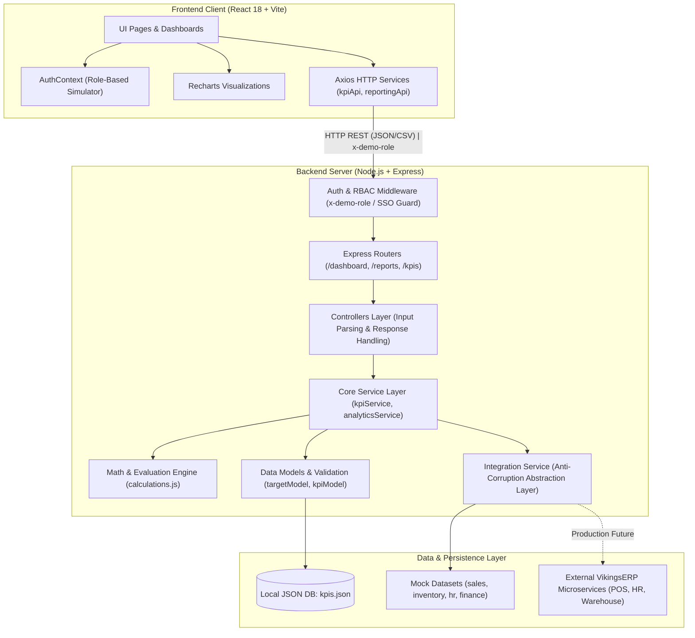
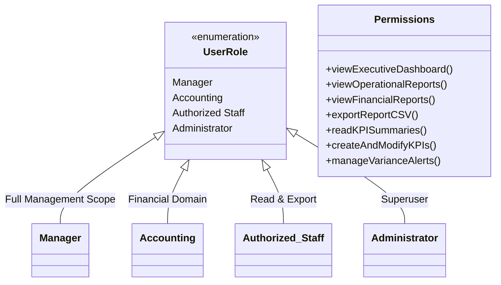

# Technical Documentation: VikingsERP Reporting & Analytics (RA) and KPI Management Suite

> **Module Name:** `vikings_ra_kpi_module`  
> **System Classification:** Business Intelligence, Operational Auditing & Performance Evaluation Subsystem  
> **Version:** 1.0.0 (Architecture Baseline & Starter Prototype)  
> **Target Environment:** Node.js 20+, Modern Browsers (ES2022+), Windows/Linux POSIX

---

## 1. System Overview

The **VikingsERP Management Suite** is a centralized decision-support subsystem designed for the **Vikings** hospitality group (buffet restaurants, billiards, KTV, and event dining). The module delivers executive intelligence, automated KPI tracking, variance detection, and cross-department operational reporting across sales, warehouse inventory, human resources, diner feedback, and financial statements.

### 1.1 Architecture Topology
The codebase follows a decoupled **Full-Stack Monorepo** architecture structured into two independent tiers:
- **`backend/`**: Node.js & Express REST API implementing a layered service-oriented design with an Anti-Corruption Layer (ACL) for external microservice communication.
- **`frontend/`**: Single-Page Application (SPA) powered by React 18 and Vite 6, using client-side routing, responsive data visualization, and a dark Viking Red theme.



---

## 2. Directory Structure

```
vikings_ra_kpi_module/
├── .gitignore                      # Top-level Git ignore rules (node_modules, .env, data/*.json)
├── README.md                       # High-level system overview & quickstart
├── TECHNICAL_DOCUMENTATION.md      # Comprehensive technical documentation
├── backend/
│   ├── .env.example                # Backend environment configuration template
│   ├── .gitignore                  # Backend-specific ignore rules
│   ├── package.json                # Express, CORS, Dotenv dependencies
│   ├── data/
│   │   └── kpis.json               # Auto-bootstrapped local KPI target storage
│   └── src/
│       ├── app.js                  # Express application setup & middleware assembly
│       ├── server.js               # HTTP server listener entry point
│       ├── config/
│       │   ├── database.js         # Atomic JSON read/write persistence adapter
│       │   └── env.js              # Environment variable parser with defaults
│       ├── controllers/
│       │   ├── dashboardController.js
│       │   ├── kpiController.js
│       │   └── reportingController.js
│       ├── data/
│       │   └── mock.js             # Seed datasets for POS, inventory, HR, feedback, finance
│       ├── middleware/
│       │   ├── authMiddleware.js   # Session/role extractor & production guard
│       │   ├── errorMiddleware.js  # Global centralized exception handler
│       │   └── roleMiddleware.js   # Granular RBAC endpoint authorization
│       ├── models/
│       │   ├── kpiModel.js         # CRUD repository for KPI entity persistence
│       │   ├── reportModel.js      # Aggregation model for operational data
│       │   └── targetModel.js      # Metric registry & payload validation schema
│       ├── routes/
│       │   ├── dashboardRoutes.js  # /api/dashboard routing
│       │   ├── kpiRoutes.js        # /api/kpis CRUD, results, alerts, history
│       │   └── reportingRoutes.js  # /api/reports category summaries & CSV exports
│       ├── services/
│       │   ├── analyticsService.js # Category breakdown, inventory risk, feedback sentiment
│       │   ├── integrationService.js # External ERP microservice abstraction layer
│       │   ├── kpiService.js       # Target evaluation & variance calculation
│       │   └── reportingService.js # Aggregation endpoints & metric extractors
│       └── utils/
│           ├── calculations.js     # Pure mathematical & statistical algorithms
│           └── exportHelper.js     # RFC-4180 CSV serializer with UTF-8 BOM
└── frontend/
    ├── .env.example                # Frontend environment template (VITE_API_URL)
    ├── .gitignore                  # Frontend ignore rules (node_modules, dist, .env)
    ├── index.html                  # HTML5 shell with Cinzel & Inter Google Fonts
    ├── package.json                # React 18, React Router v6, Recharts, Lucide
    ├── vite.config.js              # Vite build configuration
    └── src/
        ├── App.jsx                 # Route definitions and layout nesting
        ├── main.jsx                # Application root rendering and providers
        ├── index.css               # Global theme tokens, typography, layouts, tables, pills
        ├── components/
        │   ├── charts/
        │   │   ├── InventoryChart.jsx # Recharts BarChart for stock vs reorder point
        │   │   ├── KPIChart.jsx       # Recharts BarChart for target achievement rates
        │   │   └── SalesChart.jsx     # Recharts AreaChart with gradient revenue fill
        │   ├── common/
        │   │   ├── DataTable.jsx   # Generic reusable tabular component
        │   │   ├── DateFilter.jsx  # Temporal range filter bar
        │   │   └── StatCard.jsx    # Metric tile with icon, title, value, and badge
        │   └── layout/
        │       ├── MainLayout.jsx  # Flex shell combining Sidebar and Navbar
        │       ├── Navbar.jsx      # Header breadcrumbs, role selector, connection pill
        │       └── Sidebar.jsx     # Grouped navigation links with active indicators
        ├── context/
        │   └── AuthContext.jsx     # React context managing active demo role and RBAC
        ├── pages/
        │   ├── Dashboard.jsx       # Executive high-level operational overview
        │   ├── kpi/
        │   │   ├── KPIAlerts.jsx             # Active variance and critical shortfall flags
        │   │   ├── KPIDashboard.jsx          # Live metric goal progress trackers
        │   │   ├── KPIHistory.jsx            # 7-day compliance timeline
        │   │   ├── KPIManagement.jsx         # CRUD registry of active benchmarks
        │   │   ├── PerformanceEvaluation.jsx # Audited actuals vs. benchmark matrix
        │   │   └── TargetManagement.jsx      # Benchmark creation and configuration form
        │   └── reporting/
        │       ├── ConsolidatedReports.jsx   # Multi-department synthesis
        │       ├── FeedbackAnalytics.jsx     # Sentiment and star distribution
        │       ├── FinancialReports.jsx      # P&L, revenue, expenses, net income
        │       ├── HRAnalytics.jsx           # Headcount, present/absent, attendance rate
        │       ├── InventoryAnalytics.jsx    # Commodity stock, health %, low-stock items
        │       ├── ReportExport.jsx          # CSV download generator
        │       └── SalesAnalytics.jsx        # Daily sales records, category distribution
        └── services/
            ├── api.js              # Axios instance with request header interceptor
            ├── kpiApi.js           # KPI client endpoint methods
            └── reportingApi.js     # Reporting client endpoint methods
```

---

## 3. Frontend Architecture

### 3.1 Routing & Navigation Table

| URL Route | Associated Page Component | Permitted Roles | Functional Purpose |
| :--- | :--- | :--- | :--- |
| `/dashboard` | `Dashboard.jsx` | Manager, Administrator | Executive overview: sales, covers, low-stock, net income, 7-day revenue trend. |
| `/reporting/sales` | `SalesAnalytics.jsx` | Manager, Administrator | Detailed sales ledger, daily order breakdown, buffet vs beverage categories. |
| `/reporting/inventory` | `InventoryAnalytics.jsx` | Manager, Administrator | Stock monitoring, reorder point tracking, critical deficit detection. |
| `/reporting/hr` | `HRAnalytics.jsx` | Manager, Administrator | Headcount presence, daily attendance percentage, absenteeism logs. |
| `/reporting/feedback` | `FeedbackAnalytics.jsx` | Manager, Administrator | Customer rating averages, sentiment distribution (Positive/Neutral/Negative). |
| `/reporting/financial` | `FinancialReports.jsx` | Manager, Accounting, Admin | P&L summary, operating expenditure, gross margin, net operational income. |
| `/reporting/consolidated` | `ConsolidatedReports.jsx` | Manager, Administrator | Unified executive snapshot compiling all five operational domains. |
| `/reporting/export` | `ReportExport.jsx` | Manager, Authorized Staff, Admin | Dataset exporter generating UTF-8 BOM CSV files for Excel/Sheets. |
| `/kpi` | `KPIDashboard.jsx` | Manager, Authorized Staff, Admin | Visual achievement gauges, category distributions, progress bars. |
| `/kpi/manage` | `KPIManagement.jsx` | Manager, Administrator | Configured benchmark registry with edit, status, and delete controls. |
| `/kpi/targets` | `TargetManagement.jsx` | Manager, Administrator | Formulation form to create and configure custom quantitative thresholds. |
| `/kpi/evaluation` | `PerformanceEvaluation.jsx`| Manager, Authorized Staff, Admin | Audit matrix calculating actual outputs against targets. |
| `/kpi/history` | `KPIHistory.jsx` | Manager, Authorized Staff, Admin | 7-day compliance timeline and historical performance trajectory. |
| `/kpi/alerts` | `KPIAlerts.jsx` | Manager, Administrator | Filtered view isolating failing metrics requiring managerial intervention. |

### 3.2 Design System Tokens (`index.css`)
The UI follows the **Viking Charcoal & Red Theme** with strict CSS custom property tokenization:

```css
:root {
  /* Canvas & Surface Scale */
  --bg-app: #121212;
  --bg-sidebar: #1a1a1a;
  --bg-surface: #222222;
  --bg-elevated: #2a2a2a;
  --bg-input: #1e1e1e;

  /* Viking Red Brand Tokens */
  --color-primary: #8B1A1A;
  --color-primary-hover: #A52A2A;
  --color-primary-light: #B03030;
  --color-primary-dark: #6B1010;
  --color-primary-glow: rgba(139, 26, 26, 0.35);

  /* Typography & Borders */
  --text-main: #FFFFFF;
  --text-muted: #CCCCCC;
  --text-faint: #888888;
  --border-subtle: #333333;
  --border-light: #3d3d3d;
  --border-focus: #8B1A1A;

  /* Typography Families */
  --font-main: 'Inter', system-ui, sans-serif;
  --font-heading: 'Cinzel', 'Georgia', serif;
}
```

---

## 4. Backend Architecture & REST API Specification

### 4.1 Base Configuration & Middleware Pipeline
1. **`cors`**: Locks cross-origin requests to `env.FRONTEND_ORIGIN` (`http://localhost:5173`).
2. **`express.json({ limit: '100kb' })`**: Protects against denial-of-service payload abuse.
3. **`authenticate` (`authMiddleware.js`)**:
   - Inspects the `x-demo-role` HTTP header.
   - When `DEMO_MODE=false`, halts unauthenticated execution and returns `503 Service Unavailable`, guaranteeing prototype access patterns cannot be accidentally exposed in production.
4. **`permit(...roles)` (`roleMiddleware.js`)**:
   - Validates user role against route permission requirements, returning `403 Forbidden` on unauthorized access.
5. **`errorMiddleware`**: Centralized catch-all handler returning consistent `{ error: string }` JSON structures.

### 4.2 Complete API Endpoint Catalog

| Method | Endpoint | Authorized Roles | Description | Request Query/Body | Status Codes |
| :--- | :--- | :--- | :--- | :--- | :--- |
| `GET` | `/api/health` | Public | System health check & uptime monitor | None | `200` |
| `GET` | `/api/dashboard` | Manager, Admin | Aggregated executive KPIs and sales trend | None | `200`, `401`, `403` |
| `GET` | `/api/reports/sales` | Manager, Admin | Sales records with optional filtering | `?from=YYYY-MM-DD&to=YYYY-MM-DD&category=Buffet` | `200`, `401`, `403` |
| `GET` | `/api/reports/inventory` | Manager, Admin | Inventory list with low stock detection | None | `200`, `401`, `403` |
| `GET` | `/api/reports/hr` | Manager, Admin | Workforce attendance and presence | None | `200`, `401`, `403` |
| `GET` | `/api/reports/feedback` | Manager, Admin | Review averages and sentiment counts | None | `200`, `401`, `403` |
| `GET` | `/api/reports/financial` | Manager, Accounting, Admin | P&L statements and margin calculation | None | `200`, `401`, `403` |
| `GET` | `/api/reports/consolidated` | Manager, Admin | Unified multi-domain summary object | None | `200`, `401`, `403` |
| `GET` | `/api/reports/metrics` | Manager, Staff, Admin | Raw calculated numeric metrics | None | `200`, `401`, `403` |
| `GET` | `/api/reports/export` | Manager, Staff, Admin | Generates RFC-4180 CSV attachment | `?type=sales` or `?type=inventory` | `200`, `400`, `401`, `403` |
| `GET` | `/api/kpis` | Manager, Staff, Admin | Returns all configured KPI benchmarks | None | `200`, `401`, `403` |
| `GET` | `/api/kpis/:id` | Manager, Staff, Admin | Retrieve a specific KPI definition | URL param `:id` (Integer) | `200`, `404`, `401`, `403` |
| `POST` | `/api/kpis` | Manager, Admin | Create a new quantitative benchmark | `JSON: { name, metricKey, target, comparison, unit }` | `201`, `400`, `401`, `403` |
| `PATCH`| `/api/kpis/:id` | Manager, Admin | Partially update an existing benchmark | `JSON: { name?, target?, comparison?, unit? }` | `200`, `404`, `401`, `403` |
| `DELETE`| `/api/kpis/:id` | Manager, Admin | Permanently delete a KPI benchmark | URL param `:id` (Integer) | `200`, `404`, `401`, `403` |
| `GET` | `/api/kpis/results` | Manager, Staff, Admin | Live achievement rate evaluations | None | `200`, `401`, `403` |
| `GET` | `/api/kpis/alerts` | Manager, Admin | Filtered list of failing KPI targets | None | `200`, `401`, `403` |
| `GET` | `/api/kpis/history` | Manager, Staff, Admin | 7-day compliance timeline history | None | `200`, `401`, `403` |

---

## 5. Data Models & Metrics Registry

### 5.1 KPI Target Schema (`backend/data/kpis.json`)
```typescript
interface KPITarget {
  id: number;                          // Unique auto-incrementing integer identifier
  name: string;                        // Human-readable title (e.g. "Monthly Sales Target")
  metricKey: "total_sales"             // Key identifying calculation source
           | "net_income"
           | "attendance_rate"
           | "average_rating"
           | "low_stock_items";
  target: number;                      // Numeric threshold benchmark (> 0)
  comparison: "at_least" | "at_most";  // Evaluation condition
  unit: string;                        // Unit of measure: "PHP", "%", "items", "/5"
  createdAt: string;                   // ISO 8601 timestamp
  updatedAt?: string;                  // ISO 8601 timestamp
}
```

### 5.2 Evaluated KPI Result Schema
```typescript
interface KPIEvaluationResult extends KPITarget {
  actual: number;                      // Current output computed by the reporting engine
  achievementRate: number;             // Percentage: ((actual / target) * 100)
  status: "on_target" | "below_target";// Result of comparison evaluation
  evaluatedAt: string;                 // ISO 8601 execution timestamp
  source: "demo" | "live";             // Data provenance indicator
}
```

### 5.3 Metric Definitions Registry (`targetModel.js`)

| Key | Domain | Default Unit | Comparison | Calculation Rule |
| :--- | :--- | :--- | :--- | :--- |
| `total_sales` | Sales | `PHP` | `at_least` | $\sum \text{amount}$ across completed order records |
| `net_income` | Finance | `PHP` | `at_least` | $\text{Revenue} - \text{Expenses}$ |
| `attendance_rate` | HR | `%` | `at_least` | $(\frac{\text{presentStaff}}{\text{totalStaff}}) \times 100$ |
| `average_rating` | Feedback | `/5` | `at_least` | Arithmetic mean of verified diner star ratings |
| `low_stock_items`| Inventory | `items` | `at_most` | $\text{Count of items where } \text{quantity} < \text{reorderPoint}$ |

---

## 6. Business Logic & Mathematical Formulations

### 6.1 Achievement Rate Algorithm (`calculations.js`)
$$\text{Achievement Rate} = \begin{cases} 0 & \text{if } \text{target} \le 0 \\ \operatorname{round}\left(\frac{\text{actual}}{\text{target}} \times 100, 1\right) & \text{otherwise} \end{cases}$$

### 6.2 Compliance Evaluation Algorithm (`determineKPIStatus`)
$$\text{Status} = \begin{cases} 
\text{"on\_target"} & \text{if } \text{comparison} = \text{"at\_most"} \land \text{actual} \le \text{target} \\ 
\text{"on\_target"} & \text{if } \text{comparison} = \text{"at\_least"} \land \text{actual} \ge \text{target} \\ 
\text{"below\_target"} & \text{otherwise} 
\end{cases}$$

### 6.3 Inventory Risk Categorization (`analyticsService.js`)
- **Normal Stock:** $\text{quantity} \ge \text{reorderPoint}$
- **Low Stock:** $\text{quantity} < \text{reorderPoint}$
- **Critically Low Stock:** $\text{quantity} \le \frac{\text{reorderPoint}}{2}$
- **Stock Health Index:** 
  $$\text{Stock Health \%} = \left(\frac{\text{totalItems} - \text{lowStockCount}}{\text{totalItems}}\right) \times 100$$

### 6.4 Sentiment Distribution (`analyticsService.js`)
For positive, neutral, and negative customer responses:
$$\text{Sentiment \%} = \operatorname{round}\left(\frac{\text{Count}_{\text{sentiment}}}{\text{Total Responses}} \times 100, 1\right)$$

---

## 7. Role-Based Access Control (RBAC) Security Matrix



| Functional Capability | Manager | Accounting | Authorized Staff | Administrator |
| :--- | :---: | :---: | :---: | :---: |
| **Executive Dashboard Access** | ✅ | ❌ | ❌ | ✅ |
| **Sales, Inventory, HR Analytics** | ✅ | ❌ | ❌ | ✅ |
| **Customer Feedback Sentiment** | ✅ | ❌ | ❌ | ✅ |
| **Financial Statements & P&L** | ✅ | ✅ | ❌ | ✅ |
| **Consolidated Multi-Domain View** | ✅ | ❌ | ❌ | ✅ |
| **CSV Audit Report Export** | ✅ | ❌ | ✅ | ✅ |
| **KPI Registry & Results (Read)** | ✅ | ❌ | ✅ | ✅ |
| **KPI CRUD (Create, Update, Delete)**| ✅ | ❌ | ❌ | ✅ |
| **Operational Variance Alerts** | ✅ | ❌ | ❌ | ✅ |

---

## 8. Export Engine Specification (`exportHelper.js`)

1. **Format Compliance:** Generates strict RFC-4180 CSV strings with double-quoted cells (`"value"`) and escaped internal quotes (`""`).
2. **Excel Compatibility:** Prepends the UTF-8 Byte Order Mark (`\ufeff`) to ensure Microsoft Excel and Google Sheets open the document without character corruption.
3. **HTTP Streaming Headers:**
   ```http
   Content-Type: text/csv; charset=utf-8
   Content-Disposition: attachment; filename="sales-report.csv"
   ```

---

## 9. Production Migration & Integration Roadmap

### Phase 1: Identity & Authentication Integration
- Deprecate `x-demo-role` simulation.
- Introduce an OAuth 2.0 / OIDC Bearer token verification middleware validating signatures from the centralized VikingsERP Identity Provider (IdP).

### Phase 2: Microservice Connectors
- Update `backend/src/services/integrationService.js` to replace `mock.js` calls with authenticated HTTP/gRPC requests against:
  - **Vikings POS Service**: For live transaction streams and daily covers.
  - **Vikings Inventory Service**: For real-time bin counts and purchase orders.
  - **Vikings HR/Biometrics Service**: For RFID/facial recognition punch logs.
  - **Vikings Financial Ledger**: For GL expense allocations and COGS.

### Phase 3: Relational Database Migration
- Transition `backend/data/kpis.json` to the central VikingsERP relational database (PostgreSQL / MySQL).
- Implement standard migration scripts using Prisma or Knex.js with audit trail tracking (`created_by`, `updated_by`).
